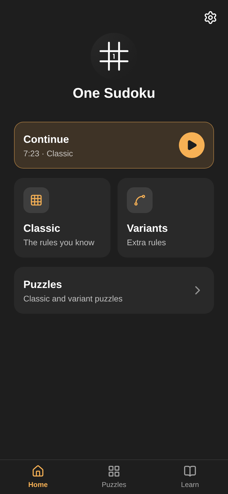
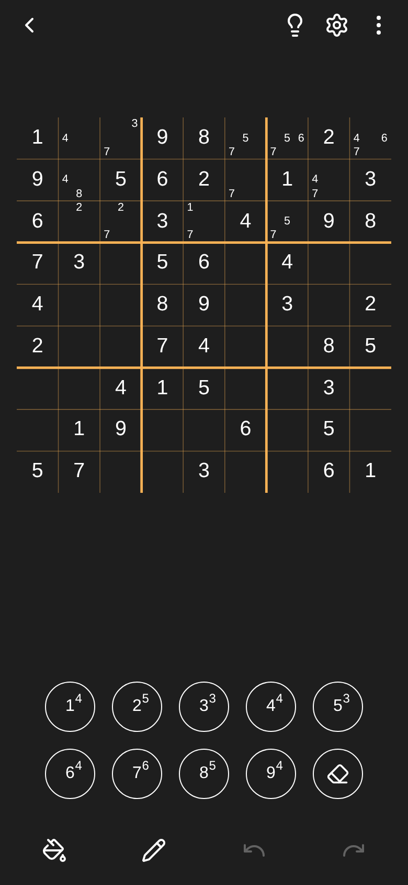
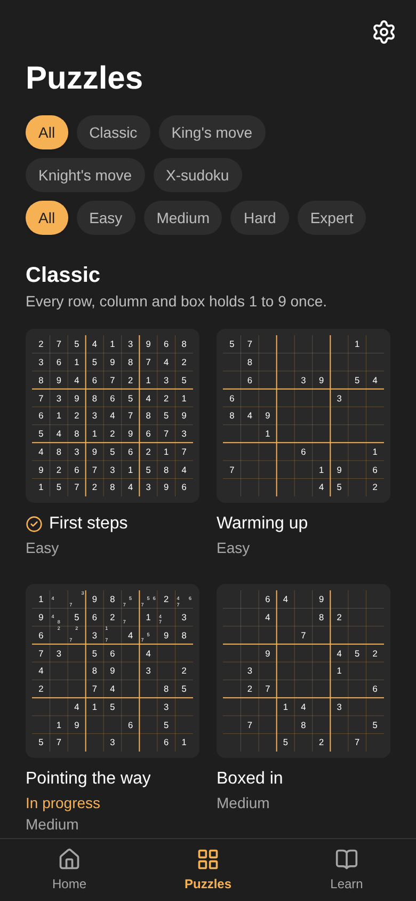

<p align="center">
  
</p>

<h1 align="center">One Sudoku</h1>

<p align="center">
  A Rust constraint-based Sudoku solver paired with a Tauri + SvelteKit app.
</p>

<p align="center">
  
  
  
</p>

## Project structure

- [`crates/sudoku-solver`](crates/sudoku-solver) - Constraint-based solver with pluggable strategies (naked single, hidden single, pointing pair, box/line reduction) that produce step-by-step `Deduction`s with explanations, intended for both solving and hint generation.
- [`src`](src), [`src-tauri`](src-tauri) — SvelteKit frontend and Tauri shell for the app.

## Prerequisites

- [Rust](https://www.rust-lang.org/tools/install) (stable)
- [Node.js](https://nodejs.org/) (v26+)
- [pnpm](https://pnpm.io/installation) (v10+)
- [Tauri prerequisites](https://v2.tauri.app/start/prerequisites/) for your platform (system dependencies vary by OS)

## Running the app

```sh
pnpm install
pnpm tauri dev
```

## Screenshots

The screenshots above are taken with Playwright against the Vite dev server, with Tauri's IPC mocked and a game in progress seeded (see [`scripts/screenshots.ts`](scripts/screenshots.ts)):

```sh
pnpm exec playwright install chromium # once
pnpm screenshots
```

## Solver tests

```sh
cargo test --package sudoku-solver
```

Or a single test file, e.g.:

```sh
cargo test --package sudoku-solver --test hidden_single
```

## Solver benchmarks

Criterion benches live in [`crates/sudoku-solver/benches`](crates/sudoku-solver/benches).

```sh
cargo bench --package sudoku-solver --bench solve
```

Re-runs compare against the previous run stored in `target/criterion/`, so regressions are reported automatically.
